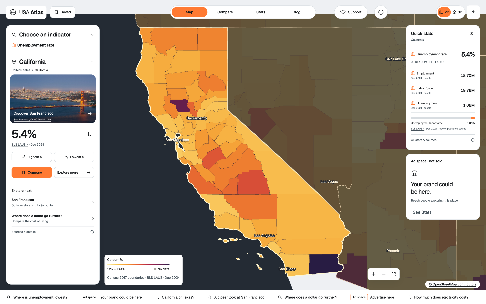
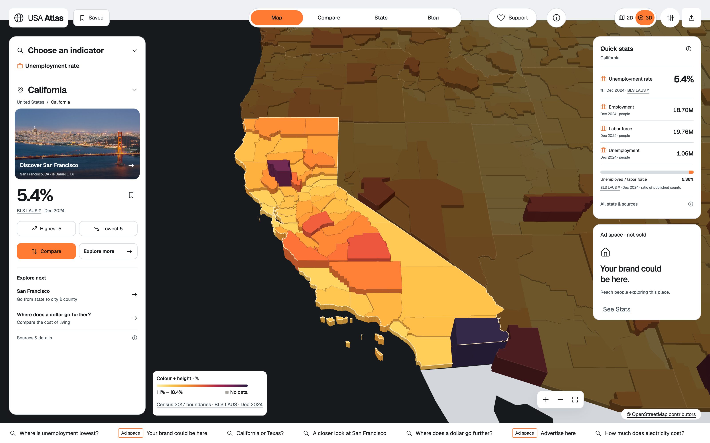
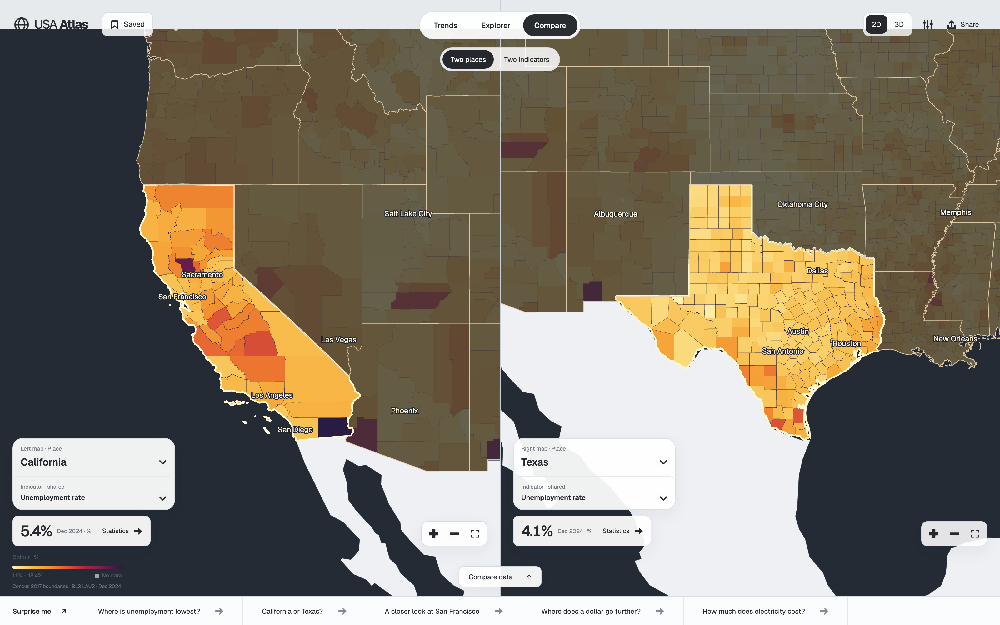
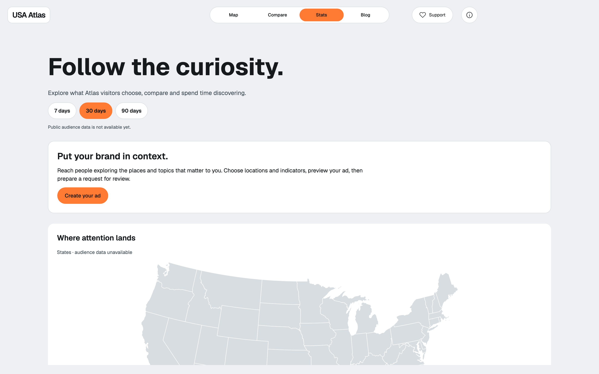
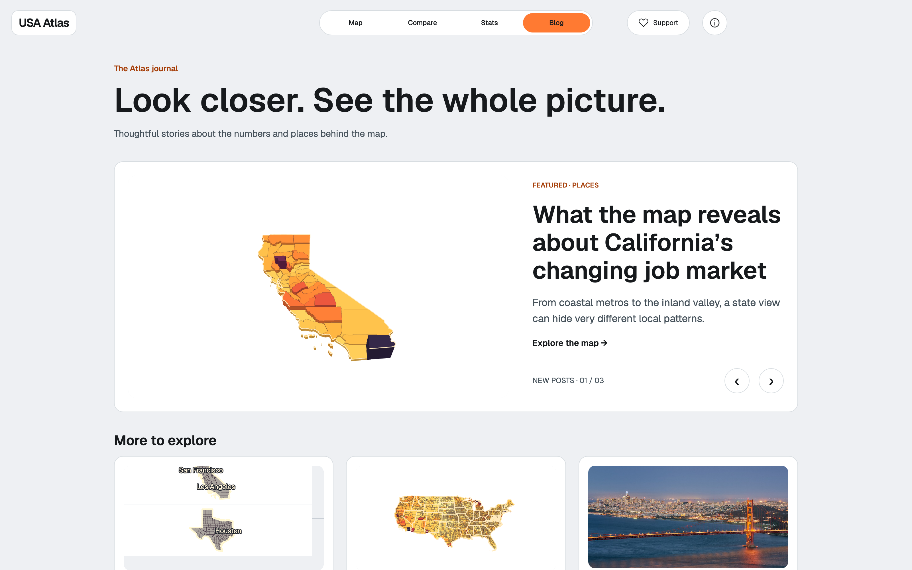
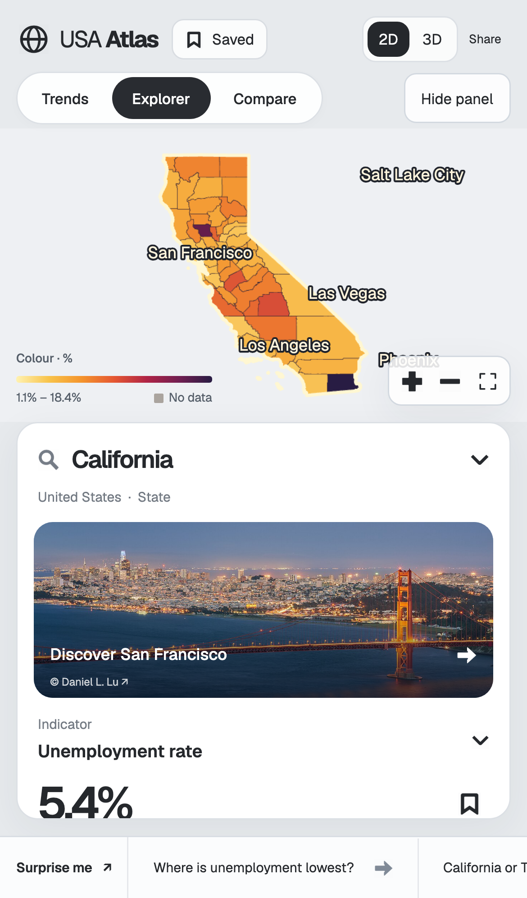
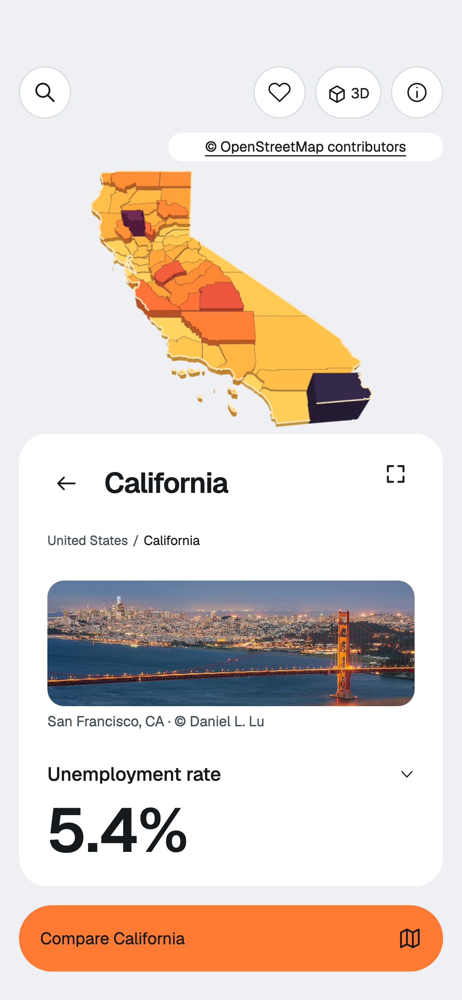
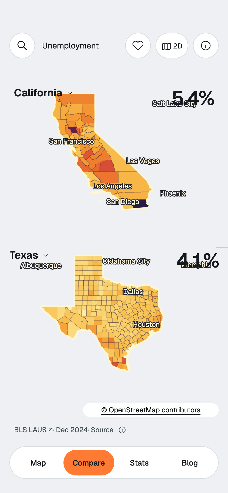

# USA Atlas

[](https://github.com/66dplus/usa-atlas-design-lab/actions/workflows/ci.yml)

USA Atlas is an interactive atlas of US statistics. It links indicators to state and county geography, shows data sources and periods, and lets you explore the map in 2D and 3D.

> This is a prototype for local runs. The live atlas reads data from a separate PostgreSQL database; the database and its credentials are not part of the repository. Project source code and documentation are available under the MIT license.

## Screenshots

Real observations from the connected `usa_atlas` database: unemployment rate by county, December 2024 (BLS LAS). Captured from a local run of this repository.

<p align="middle">
  
  
  
  
  
</p>

The same atlas on a phone:

<p align="middle">
  
  
  
</p>

## 2D renderer: owner decision, 24 October 2026

All 2D maps use WebGL. The legacy SVG geographic renderer and automatic SVG
fallback have been removed at the owner's request. Old `renderer=svg` links open
WebGL and the obsolete renderer parameter is removed when the URL is saved.
WebGL failure shows an explicit map error with a retry button. Transparent SVG
text labels and the existing D3 gesture surface remain; they contain no county,
state or world paths and do not render the geographic map. The 3D renderer remains
WebGL. The [October comparison](docs/webgl-comparison-2026-10-11.md) is historical.
City membership is cached by state feature so detailed polygon containment is not
repeated on every 2D pan/zoom frame.

## Current interface — Paper runtime, promoted 20 October 2026

The runtime shell is the approved Paper design. The header carries the **Map / Compare / Stats / Blog** modes, a Saved panel, Support and About, and a 2D/3D switch; a light and a dark theme apply to the whole interface and are chosen in About → Appearance. Info and Support are their own screens, and leaving them returns to the page you came from.

On Desktop the map is the workspace. The left panel holds the indicator, the place, a place photograph, the headline value with its unit, period and source, Highest 5 and Lowest 5, and a Compare action. The right column shows quick statistics for the selected place, each with its own period and source, above a labelled advertising slot. The bottom ticker surfaces prepared questions and advertising; it stops on hover and focus and respects reduced motion. 3D is the same selected indicator as colour and height on one labelled scale. Compare places two independent cameras side by side and switches to two indicators, with a compare-data drawer for the numbers.

On a phone the map keeps the top of the screen and the place panel becomes a bottom sheet that expands over the map; Compare stacks the two place maps, and a docked bar switches modes. The source and geometry popups, the camera controls and the sheet transitions follow the same rules on both sizes.

The indicator pickers share one set of display switches: 39 collected fields are enabled — the 36 collected map indicators plus the three admitted medical fields. Only the enabled fields whose default series the connected database has admitted appear in a picker, so the number you see depends on that database. A missing observation stays an explicit gap: a state value is never spread over its counties, and no US average is computed from states.

The Blog is the Atlas journal. It shows live map previews and two editorial drafts that are still marked review pending. Stats is the audience view; no public audience data is connected, so its figures read as unavailable rather than zero.

## What to open

After starting the server:

- **Interactive atlas:** [http://127.0.0.1:4180/ux/](http://127.0.0.1:4180/ux/) — place search, indicators, state and county comparison, the 2D map and the 3D relief.
- **Concept gallery:** [http://127.0.0.1:4180/](http://127.0.0.1:4180/) — an early design study with synthetic demo values. These values are not statistics.
- **Advertising studio:** [http://127.0.0.1:4180/ux/advertise.html](http://127.0.0.1:4180/ux/advertise.html) — an experimental editor with the accepted Creative and Request layout. It keeps drafts in the browser and downloads a review request; delivery is not configured. Its local preview is built separately from the connected database's data, so the generated snapshot and bundle are intentionally not stored in Git. Instructions live in [ux/advertising/DESIGN.md](ux/advertising/DESIGN.md).

The local review panel that records map feedback is a development tool: it is off by default, and `?review=1` on the atlas URL opens it while reviewing designs.

In the atlas, a missing observation remains an explicit gap. A state value is not distributed over counties, ZIP-code or monitoring-station values are not converted to counties, and a US average is not computed from states.

## Quick start

You need Node.js with npm and Python 3. For real data you also need <code>psql</code> and access to the <code>usa_atlas</code> PostgreSQL database.

~~~sh
git clone https://github.com/66dplus/usa-atlas-design-lab.git
cd usa-atlas-design-lab
npm ci
npm start
~~~

The server prints its address and keeps running in the terminal. Open <code>/ux/</code> for the atlas or <code>/</code> for the gallery. The local server binds to <code>127.0.0.1</code>; it is a development server, not a ready public-hosting configuration.

The gallery at <code>/</code> runs without a database connection. <code>/ux/</code> also loads, but real values stay unavailable until the PostgreSQL connection is configured.

## Connecting data

Collection and loading belong to a separate repository, [usa-atlas-data-collection](https://github.com/66dplus/usa-atlas-data-collection). This interface does not run the collector and receives no data-provider keys. It reads published observations through a compatible PostgreSQL contract in the <code>usa_atlas</code> schema.

To get data for the map, run collection, validation, admission and loading per [the database instructions in the collector repository](https://github.com/66dplus/usa-atlas-data-collection/blob/main/database/README.md). The UI and the collector must point at the same <code>usa_atlas</code> database; there is no need to pass CSV, JSON or collector code into the UI repository. After a successful loading check, reopen the atlas page — the catalog and series load from the database on request.

The working atlas needs an available <code>usa_atlas</code> database, contract tables (<code>catalog_field</code>, <code>observation</code>, <code>ingest_run</code>), completed loads with status <code>pass</code>, and the <code>psql</code> client installed. Set the libpq variables in the environment before starting the application; keep secrets outside the repository, for example in a PostgreSQL password file with restricted permissions:

~~~sh
export PGHOST=127.0.0.1
export PGPORT=5432
export PGUSER=usa_atlas_reader
export PGPASSFILE=/path/outside/the/repository/pgpass
psql -X -d usa_atlas -c 'SELECT source, row_count, status FROM usa_atlas.ingest_run'
npm start
~~~

Point <code>PGHOST</code> and <code>PGPORT</code> at the same database the collector loads into. Do not expose PostgreSQL to the internet for a local UI. The server touches the database only in read transactions. The database name is fixed as <code>usa_atlas</code>; <code>PGDATABASE</code> does not override it. The password never reaches the browser. If the connection is not configured, the atlas API reports data unavailability; the concept gallery keeps working.

The integration goes through <code>GET /api/atlas/catalog</code> and <code>GET /api/atlas/observations?field=...</code>. The UI admits only successfully loaded catalog records, displays state and county observations, and matches counties to Census 2017 geometry by exact FIPS. Other geography levels and collector records without a UI adapter stay in the database and do not turn into estimates for the map. The adapter accepts only two known catalog versions — the original with 81 indicators and the versioned one with 87; an unknown or partial format is rejected. Any change to the catalog format, indicator ID, value type or geography ID must come with a compatible UI change and checks on both sides.

## Public deployment

The published atlas is **https://usa-xray.online** (and `https://www.usa-xray.online`).
This repository is the single source of that site. The `trycloudflare.com` review
tunnel was retired on 21 October 2026 and is no longer a public address for the
atlas.

The server is `62.171.154.202` (Ubuntu 24.04) and the chain is:

```text
public DNS (Spaceship: launch1/launch2.spaceship.net, A -> 62.171.154.202)
  -> nginx :80 / :443, TLS from Let's Encrypt, HTTP redirects to HTTPS
  -> 127.0.0.1:8099 host-header rewriting origin proxy
  -> 172.19.0.4:4429 read-only preview container
  -> read-only PostgreSQL `usa_atlas`
```

A release is built from this repository with the read-only packaging script, which
also records the binding in `ux/build.json`:

~~~sh
python3 scripts/build_temporary_preview.py /tmp/atlas-release --release <release-id>
~~~

`ux/build.json` carries the `release` identifier, the `sourceBaseCommit` the build
came from, and the SHA-256 of every shipped source and contract file. The live file
is at `https://usa-xray.online/ux/build.json`, so the published site always names
the commit it was built from. The current live release is `20261025-seo-routes-dd3d97`, based on source commit
`dd3d97d829e85e341b051538707298bd943dea31`. It adds canonical geography, indicator,
comparison and page routes with server-rendered search metadata, permanent legacy
URL redirects, a 57-route sitemap, and explicit noindex handling for Stats and
unpublished Blog content. The published bytes are bound by the raw manifest in
[`docs/releases/20261025-seo-routes-dd3d97/public-build.json`](docs/releases/20261025-seo-routes-dd3d97/public-build.json); the full application-side evidence is in that release folder. The recovered runtime remains the baseline for version binding.

The public runtime is read-only. It serves the same admitted observations as a local
run, reads them from the `usa_atlas` database through the read-only adapter, and
never ships collector code or credentials. The local review panel
(<code>?review=1</code>) is removed from the public build by the packaging script.

## Repository layout

- <code>ux/</code> — the current atlas interface: map, catalogs, geographic assets and the journal.
- <code>scripts/serve.py</code> — the local web server and API; <code>scripts/atlas_data.py</code> — the read-only PostgreSQL adapter.
- <code>assets/</code>, <code>app.js</code>, <code>maps.js</code>, <code>scene.js</code> and <code>field.js</code> — the separate concept gallery.
- <code>deploy/</code> — examples of local analytics and mobile environments, and the read-only preview packaging. They are not needed for a basic run.
- <code>ux/assets/SOURCES.md</code> — provenance and attribution for major interface assets.
- <code>package-lock.json</code> — pinned versions of npm dependencies.

Data, saved feedback and settings must not end up in the public repository. The server stores local reviews in a sibling <code>feedback/</code> folder; the path can be overridden with <code>--feedback-dir</code>.

## Development

For a quick integrity check of the gallery run:

~~~sh
npm run check
~~~

The command checks files, geographic assets and synthetic fields. It does not require PostgreSQL. The atlas itself has its own checks in <code>ux/check-*.mjs</code>: the flat topology and picking suite, the volume geometry and detail suites, the motion suite, the data-store suite, the source-metadata suite, the approved-icon suite and the runtime suite. The Python suites in <code>scripts/test_*.py</code> cover the adapter, the catalog contract, the preview cache and the local server. Continuous integration must run required browser and PostgreSQL gates with those services available; a required gate must fail when its tool or service is missing. Verify the relevant code in <code>ux/</code> and <code>scripts/</code> before sending changes.

When changing data, keep the original values, units, period, source release and exact geography matching. Do not fill gaps with computations and do not change the geography level without changing the contract and the documentation.

## Privacy and external services

- Analytics are off by default. Local setup and reporting are described in [deploy/analytics/README.md](deploy/analytics/README.md).
- Sending requests from the advertising studio is unavailable without the server variables <code>RESEND_API_KEY</code>, <code>ATLAS_AD_FROM</code> and <code>ATLAS_AD_TO</code>. Do not put them into client code or Git.
- Advertising preview data snapshots and collected bundles are generated locally. They may contain records from your database and file paths on your machine, so they are excluded from Git.
- The comment form stores a snapshot and description on the local server. Before publishing or sending a review, check that the image contains no personal data.

## License

Project source code and documentation are available under the [MIT license](LICENSE). Copyright © 2026 Dmitrii Rybkin. Third-party fonts, photographs, cartographic assets and libraries keep their own terms of use; their provenance is listed in [ux/assets/SOURCES.md](ux/assets/SOURCES.md) and in the licenses of npm dependencies.
