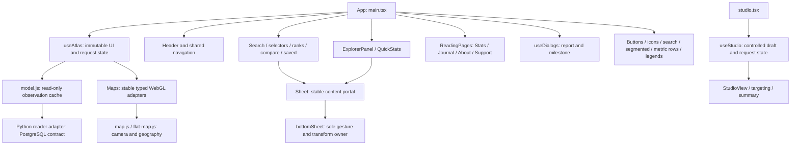

# Maintained React and TypeScript frontend

The accepted production implementation and exact owner Support/About commit `f00c82af1ec9a158d28c45a24c90f724fc8edc34` are the preservation baseline. The migration changes rendering and ownership, without redesigning copy, colors, geometry, metrics, geography, routes or interactions. The owner commit was cherry-picked alone with provenance; its feature ancestors were not imported. Paper masters remain unchanged. The before inventory and comparable screenshots are local evidence under `/tmp/usa-xray-react-ts-20261026`.

## Before and after

Previously `ux/index.html` supplied static chrome and drawer roots, `ux/app.js` combined mutable selection/data state, string templates and delegated DOM updates, and `ux/pages.js` owned reading pages, theme, history and dialogs. `journal-view.js`, `support-about-views.js` and `studio.js` rendered additional strings. Data refreshes and page swaps required manually retaining selected DOM nodes.

Now two compiled entry points, `ux/react/main.tsx` and `ux/react/studio.tsx`, render native JSX through React DOM. Their obsolete string UI implementations are removed. The HTML shell retains head metadata, crawlable noscript links and the independent startup guard. The server still renders route metadata before JavaScript runs. The map renderer, read-only data store, route rules, motion functions and mobile gesture controller remain narrow bridges; they do not render application panels. Icons reuse the canonical vector definitions as React elements. There is no legacy HTML-string mount or geographic SVG fallback.

## Responsibility and state map

| Change | Owner and boundary |
| --- | --- |
| Navigation, history, theme, selection, metric variants, comparison, ranking, drawers, source state, startup/data requests | `use-atlas.ts`, `types.ts`; React reducer updates with current refs for async callbacks. Request tokens prevent stale selection completion. Observation cache semantics remain in `model.js`. |
| Application event commands, keyboard navigation, startup UI and toast | `main.tsx`; React events route explicit semantic commands. DOM queries are limited to focus, scroll, animation and stable adapter hosts. |
| Persistent maps, map controls/summary, comparison panes, WebGL failure/retry | `maps.tsx`; `MapAdapter` is typed in `types.ts`. A and lazy B instances persist independently of reading pages and sheet snaps. Disposal occurs on owner unmount. |
| Place panel, selected value, source footer and legend | `explorer.tsx`; `metrics.tsx` shares exact row variants and source links. `data-views.tsx` renders inspectors, statistics, ranks and comparison data in original units and periods. |
| Drawer shells and content | `drawers.tsx`, `sheet.tsx`; persistent `sheetContent` portals, original supported min/half/expanded snaps and free positions, `sheetScroll` restoration. No competing touch handler or CSS transition. |
| Reading-page content and cached scroll | `reading.tsx`; native `support-about.tsx`, `journal.tsx`, `source-content.tsx`; page caches preserve mounted content and scroll while original motion functions handle entry/exit. Stats remains explicitly unavailable and does not invent audience counts. |
| Report draft, modal history, focus/inert and in-flight submission | `dialogs.tsx`; `report-state.ts` minimizes public URL context and accepts only a durable 201/saved/id acknowledgement. Closing/reopening retains one pending request. The backend owns privacy, origin validation, rate limits and durable storage. |
| Saved explorations | `saved.tsx`; same private browser storage, duplicate behavior and legacy saved-link semantics. |
| Advertising editor | `use-studio.ts`, `studio-view.tsx`, `studio-components.tsx`; controlled fields, targeting, image request races, browser drafts, validation, preview iframe messages and download-only requests. It does not deliver or publish advertising. Existing `advertising/creative.js` and `request.js` remain validation bridges. |
| Shared controls | `components.tsx`: Button variants, Icon/IndicatorIcon, Search, PanelHeader, Segmented, MetricSwitch and Status. `metrics.tsx`: explicit quick/expanded/statistics variants. Composition preserves existing DOM/classes rather than adding a general UI framework. |

`ui-tokens.css` remains the semantic palette/type/space/radius/motion source, inheriting the accepted theme values. `mobile-layout.css` alone owns mobile footer, safe areas, sheet structure and viewport geometry; existing content styles remain in `master.css`, `style.css` and `ui-overhaul.css`. `support-about.css` preserves owner values and groups identical flex-column declarations. Extend the shared component or token before introducing a local variant. Page-specific copy belongs in its React page or the existing content JSON; geography/data semantics belong in their adapters, not JSX.

## Build and package

Use the exact lockfile: `npm ci --ignore-scripts`, `npm run typecheck`, `npm run build`. Strict TypeScript checks both entries, including unused bindings. Esbuild bundles ES modules for ES2022 with the production React runtime; versions are exact, not ranges. `npm start` builds first. Local review is a separate compile define (`npm run start:review`); production compilation removes its dynamic feedback import.

The clean-source packager compiles both entries, copies only the explicit runtime allowlist, and records compiled `app.js`/`studio.js` hashes, actual frontend input hashes, lockfile and build-tool hashes. Neither node_modules wholesale, React source files, local feedback, report files, private configuration nor the dormant after-support fixture is publicly mapped. The server metadata input `journal.js` remains private. The release workflow reconstructs the same committed package with an isolated clean install; exact inventory, raw build and route-manifest bytes must match. Compilation does not change release admission or permit a dirty build.

## Preserved semantics and validation

The source store still separates raw observations from display normalization, enforces source period/geography, excludes unsupported national/state aggregates from county scales, and deduplicates requests. Census FIPS/topology, detailed boundaries, holes/islands, county picking and city-membership cache are unchanged. WebGL stays the only interactive geographic renderer; its error/retry UI is now React-owned. The approved neutral Stats orientation chart remains unchanged.

Canonical clean paths, legacy normalization, operational query preservation, SSR canonical/title/description/structured metadata, robots/sitemap and Stats/unpublished noindex remain server-side. The normal client does not persist parent iframe theme messages as a user preference. Desktop anchored drawers, embedded-map geometry, two comparison maps, single attribution node, minimum grip and independent scrolling are preserved.

`npm run check:source` includes typecheck/build and existing behavioral data/geometry/motion/icon/runtime checks plus native Support/About/privacy checks. `scripts/run_release_regressions.py` retains the complete canonical Chrome matrix and negative footer detector, then adds native React lifecycle/report, editor and actual HTTP SEO/private-boundary checks against the same runtime. Compiled packages declare the complete capability contract; unknown or missing capability metadata fails closed. Only the exact pinned archived A build/source/image may record the two newer feature suites as not applicable, with every public asset verified against its immutable manifest. Its complete current core remains mandatory. See the unified workflow for preactivation baseline rehearsal and fresh rollback receipts. CI starts the clean package with an isolated private reports directory. Required services fail clearly if absent. See the [candidate evaluation](react-typescript-evaluation-20261026.md) for actual results and limits; local checks never authorize deployment.

## Bounded dormant advertising preview

The baseline editor expects a placement/fit postMessage handshake that the maintained atlas does not emit. Under the owner's explicit no-stuck-loading correction, `use-studio.ts` settles the unsupported handshake after three seconds to the existing truthful wording “Fit has not been verified.” Custom inquiries use “Placement reference. Your creative draft is retained.” Changing draft fields or inquiry kind retains the draft and reference state. The actual iframe map loads independently; a later genuine same-origin iframe response still uses the existing validation path. No request is sent, no placement is activated, and no fit certification is invented.

The eight-case editor suite checks the bounded state, edited-field retention, real map settlement, reload persistence and download-only semantics. Mandatory loading correctness is evaluated separately from dormant end-to-end placement/fit activation, which remains outside scope and uncertified.
