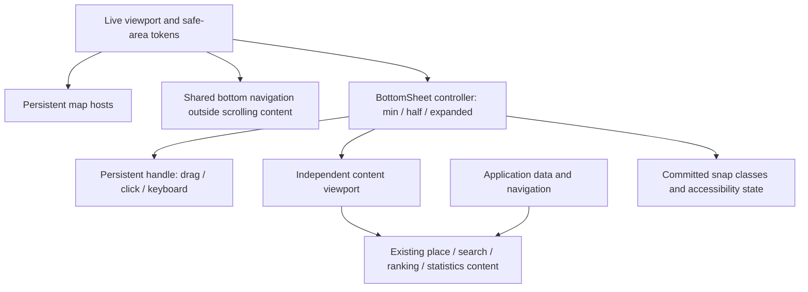

# Mobile UI architecture and acceptance

## Source and preserved baseline

The controlled interaction refactor follows `USA_XRay_Mobile_UI_Specification.docx`
(SHA-256 `3409a30dd8ab91de4947850fd61a44272d7dd121d93d49200b01d9bfb531354e`).
The baseline is commit `bf9dc8b`, copied from the reviewed working tree at
`951f70f074ded1cbf57030a70c72b4c5f843a1a5` used by release
`20261023-ui-overhaul`. All 13 public source hashes match after the documented
preview packaging transformations. Binding evidence is in
`/tmp/usa-xray-ui-architecture-20261023/baseline-binding.json`.

Keep the existing map renderer, source observations, selected-state camera,
controls, four navigation destinations, typography, colors, advertising and
reading pages. This section records the original plain JavaScript refactor. The separately authorized React migration now owns UI and state in `ux/react/`; see [the current responsibility map](application/react-typescript.md). The API contract is preserved. Paper masters remain the design authority; this change
does not edit or promote Paper frames.

## Audit before implementation

| Surface | Existing owner | Root cause / correction |
| --- | --- | --- |
| Map / compare panes | `map.js`, `app.js`, `master.css` | Map instances already persist. Preserve them; isolate viewport size from sheet position. |
| Place sheet | `renderExplorer`, `setPlaceSheet`, mobile CSS | Every data render replaces the captured grip. Minimum makes the whole panel inert and hides its grip. Root scroll and transient transforms compete with CSS top/height rules. Create one stable controller and content viewport. |
| Expanded content | `master.css` | Actions and value typography change layout at the expanded threshold. Keep the essential content mounted with consistent geometry; reveal by clipping and scrolling. |
| Other drawers | `openDrawer`, `showSurface`, renderer functions | An expand icon and generic entry animation own independent transforms. Reuse the mobile sheet controller for drawer snaps; retain desktop surface animation. |
| Bottom navigation | One `.concept-tabs` in `index.html` | The DOM is already shared. Conflicting page-specific offsets and safe-area rules cause different geometry. Give its mobile dimensions one owner. |
| Search / indicators / places | Existing static input/list nodes and delegated handlers | Keep these nodes, search behavior and semantic button variants. Wrap content once; do not regenerate static forms on snap changes. |
| Stats / Blog / Support / Info | `pages.js`, cached fragments | Preserve mounted page caches and their scroll positions. Share navigation and safe-area layout with the map. |
| Viewport / browser chrome | `index.html`, mobile CSS | `viewport-fit=cover` exists, but fixed `100dvh`, `svh` and footer offsets overlap. Use one live viewport height and semantic safe-area tokens. Sync theme-color with the active theme. |
| Tokens / controls | `style.css`, `master.css`, `icons.js`, `motion.js` | Existing theme colors and icon library are reusable. Add semantic aliases and centralized geometry/motion tokens rather than replacing brand styling. |

Baseline Chrome measurements at 390 × 844 in both themes: minimum is 100px
but inert, grip has no box; half clips a 446px document in 416px; expanded scrolls
the entire 636px panel including its grip. The map is 390 × 844 at every snap.
Evidence: `baseline-measurements.json` and `before-*.png` in the evidence folder.
The initial audit followed DIRECT. On 24 October the owner explicitly requested an independent critique; after OpenCode GLM quotas failed, the owner authorized a separate Codex reviewer. See the verification report for findings and rechecks.

## Ownership contract

`bottom-sheet.js` owns mobile snap geometry, drag ownership, velocity settlement,
interruption, resize and grip semantics. `mobile-layout.css` owns its structural
layout and shared mobile navigation. `viewport.js` owns viewport measurements and
browser theme color. `ux/react/use-atlas.ts` now owns application data, selected places and overlay visibility. `ux/react/sheet.tsx` portals React children into `sheetContent` and uses `sheetScroll` for restoration; it must not implement another drag handler.

Intentional variants: desktop drawers retain their existing anchored geometry;
embedded maps omit app chrome; comparison maps retain their two-pane composition;
reading pages use their own scroll host. All ordinary mobile drawers share the
same handle and three snap positions. The navigation footer never scrolls with a
sheet. The minimum snap is a visible state, never dismissal.

## Gesture contract

- The handle always drags the sheet, including when content is scrolled.
- A drag follows the finger immediately, clamps at minimum/maximum and settles
  to a snap using distance and recent velocity. Cancellation returns to the
  committed snap; a new drag interrupts an in-flight transition.
- Expanded content scrolls normally. A downward pull at scrollTop zero transfers
  to the sheet using that touch position as origin. A pull elsewhere stays a
  scroll. Compact content gestures move the sheet before enabling full scrolling.
- Snap changes do not mount/unmount content or recreate the map. Data refreshes
  may update content but must retain the controller, handle and scroll viewport.
- Reduced motion settles immediately. Resize recomputes snaps, preserving the
  committed state. Native Safari chrome remains controlled by Safari; document
  backgrounds and theme metadata cannot place map pixels inside browser chrome.

## Acceptance evidence

Run `node scripts/check.mjs`, relevant `ux/check-*.mjs` checks and the dedicated
sheet interaction check. Verify Chrome at 390 × 844, 360 × 640 and 1440 × 900 in
both themes, state/county, map/compare, Stats/Blog/Support, 2D/3D, all snap cycles,
scroll ownership, interruption, resize and reduced motion. Screenshots and machine
results belong under `/tmp/usa-xray-ui-architecture-20261023/`; owner feedback and
saved camera preferences must not be modified. Real iPhone Safari testing must
be reported separately and honestly if no device is connected.

## Component and token inventory

| Pattern | Canonical implementation / variants |
| --- | --- |
| Button / IconButton | Existing `.primary-button`, `.outline-button`, `.icon-button`, `.chrome-circle`; semantic HTML disabled/focus/pressed states; shared brand icons. |
| BottomNavigation / NavigationItem | Single `.concept-tabs` and `[data-page]` nodes in `index.html`, selection through `pages.js` / `slidePill`; one mobile footer in `mobile-layout.css`. |
| MapControls / MapControlButton | Existing `.dimension-control`, camera controls and `icons.js`; safe-area mobile placement in `mobile-layout.css`; persistent `ExplorerMap` instances. |
| BottomSheet / SheetHandle / SheetContent | `bottomSheet(root, {initial, onSnap})`; JSDoc `SheetSnap` union (`min`, `half`, `expanded`), persistent button handle, `.sheet-content`; no new library. |
| SheetHeader | Existing `.drawer-top` and `.profile-heading` stay inside content; the independent grip stays outside scrolling content. |
| Search / segmented / cards / text | Existing `.search-field`, `.indicator-chooser`, `.segmented`, `.category-list`, `.quick-card` and shared typography; no new duplicate implementation. |
| Color / type / spacing / radius | `ui-tokens.css` aliases the active theme (`--bg`, `--panel`, `--ink`, `--muted`, `--line`, `--accent`), type value/body/caption/label, spacing 4–24px, control/sheet radii. |
| Borders / shadows / controls / motion | Shared border width, sheet shadow, 44/48px control heights, icon size, sheet/quick durations; existing `--ease` / `--motion` retained. |
| Responsive / viewport / layering | One 760px mobile breakpoint (literal because CSS media queries cannot consume variables), safe-area tokens, measured `--app-height`, map/sheet/navigation/modal layers. |

The old `place-sheet.js` controller and its tests had no runtime import. They
were removed together rather than retaining two competing reference controllers.
Legacy mobile sheet/nav geometry and handle rules were removed from `master.css`;
the existing content styles remain. Mobile sheets bypass the generic drawer
transform animation, while desktop retains it. No dependency was added.

## Owner follow-up decisions — 24 October 2026

The four mobile top controls now start at 8 px or the real safe-area top, whichever
is larger; the old artificial 56 px status-bar allowance is removed. Navigation
stays against the available viewport bottom with its own safe-area padding.
Startup is a centered loading label with rotating geography phrases, gentle dots,
reduced-motion behavior and explicit error/retry. It has no attribution badge;
map attribution remains on the map.

The owner removed legacy SVG geographic rendering and fallback. 2D uses WebGL
only; transparent SVG text/gesture overlays have no geographic paths. Explicit
WebGL error/retry lives outside the translated camera host, with a compact
comparison variant. City membership is cached by detailed state-feature reference
so pan/zoom frames do not repeat expensive polygon containment. Replacement
detail geometry invalidates the cache. The measured label-update hotspot fell
from 158.9 ms median to under 0.1 ms for repeated updates; this is not an FPS claim.

Terrain readiness includes all 51 state meshes; mode interruption invalidates
incomplete work and reentry rebuilds it. Comparison entrance is clipped to its
viewport so animated pane translation cannot introduce document overflow.

## Owner panel-state fixes — 24 October 2026

The mobile web navigation keeps square outer edges and the existing rounded items
and active selection. Desktop design is unchanged. A dedicated pixel comparison
against `18f0770` confirms identical desktop Map, Compare, Stats and Support pages
in both themes.

Mobile attribution has one compact 10px/14px treatment and a fixed slot below the
four top controls, including Search and indicator drawers. Compare reserves that
same slot and reclaims its former empty footer space. Attribution retains its
OpenStreetMap copyright link and never covers a primary control or value.

Removed legacy expanded-sheet rules that hid Search and dimension controls,
translated Support, moved Support/Info to 50px, hid the map behind a partly open
sheet, and added a second 20px inset to the expanded indicator picker. The shared
sheet content remains the only padding owner. No Safari toolbar styling or
viewport emulation is introduced.

`ux/check-mobile-states.mjs` exercises computed font/padding/position and hit tests
through snap transitions, scrolling, focus and available-height changes, then
checks Compare, county, Stats and Support at all three viewport sizes and themes.
Results and screenshots for this release are under
`/tmp/usa-xray-mobile-states-20261024/`; the workspace release record retains the
machine-readable evidence. Physical iPhone Safari remains unverified.

## Approved Compare 01 and anchored map credit — 24 October 2026

The owner selected the real-map Compare 01 in Paper and requested white names,
chevrons and values, then explicitly authorized implementation and deployment.
The complete native source is master Mobile `27Q2-1` / `1YJL-1`; selected working
light frame `4UA7-0` in file `01M5N2NQYECYC38Y01TJWCBCAH`, page `p-19-0`.
Source-to-working mappings and exact owner decisions are retained in the workspace
`ops/mobile-states-20261024/paper/` evidence.

Mobile Compare now uses two equal, full map halves with names and values directly
on the geography. Names use the master's 18px/22px type; values use 34px/42px,
with a 24px variant for long original numeric strings. No data rounding or
substitution is introduced. Source/legend rows are removed from this compact
composition; the percentage buttons still open the existing statistics sheet.
The top shared selector, map gestures, place selection, both comparison modes,
2D/3D controls and global navigation remain available.

There is exactly one OpenStreetMap copyright link. On mobile it belongs directly
to `body`, outside translated/clipped sheets, at a fixed offset below the top
controls. Its 8px/12px type and 2px/5px padding do not change with snapping,
scrolling, page layout or available-height changes. On desktop it lives inside
the existing indicator/source frame after the Source & method button. Re-renders
and breakpoint transitions retain the same link node; overlay states use the
existing floating desktop credit when the source frame is hidden. Other desktop
layout and navigation retain the prior design.

`ux/check-compare-layout.mjs` verifies both map views, equal halves, white labels,
uncut values, source-frame placement, unique-node preservation, statistics access
and desktop/mobile breakpoint transitions. All checks still use isolated feedback
and screenshots under `/tmp`; physical iPhone Safari remains a separate check.

Desktop Compare now groups each place, indicator and observation in one compact card, 28px above the map edge. The observation shares the indicator row; the smaller colour key and statistical source follow below. The separate Compare data trigger is removed. Place, indicator, observation/statistics and source interactions retain their existing handlers. Desktop navigation and Explorer layout are unchanged.

## React lifecycle boundary — 26 October 2026

`Sheet` creates one persistent host, grip and scroll viewport per drawer. React updates the content portal; `bottomSheet` alone handles pointer/touch, free positions, transforms and settlement. Its `destroy` method aborts listeners and frames on unmount. Summary click suppression runs in capture before React receives the resulting click. `Maps` keeps each WebGL adapter alive across navigation, theme and sheet changes; the second map is created lazily and retained. The new browser suite asserts exact node identity for map/canvas/grip/scroll/credit, native grip Escape, summary drag suppression, modal focus/history and embedded theme isolation. Physical iPhone/native pinch remains a separate device gate.
